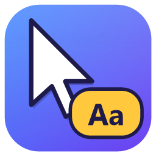
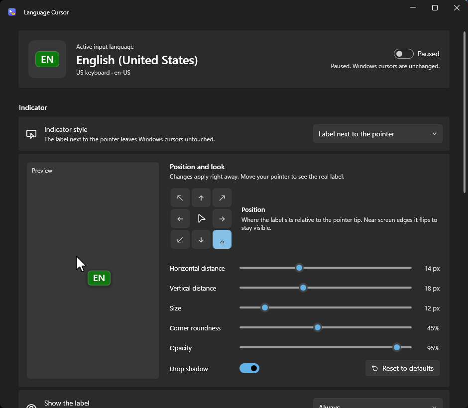
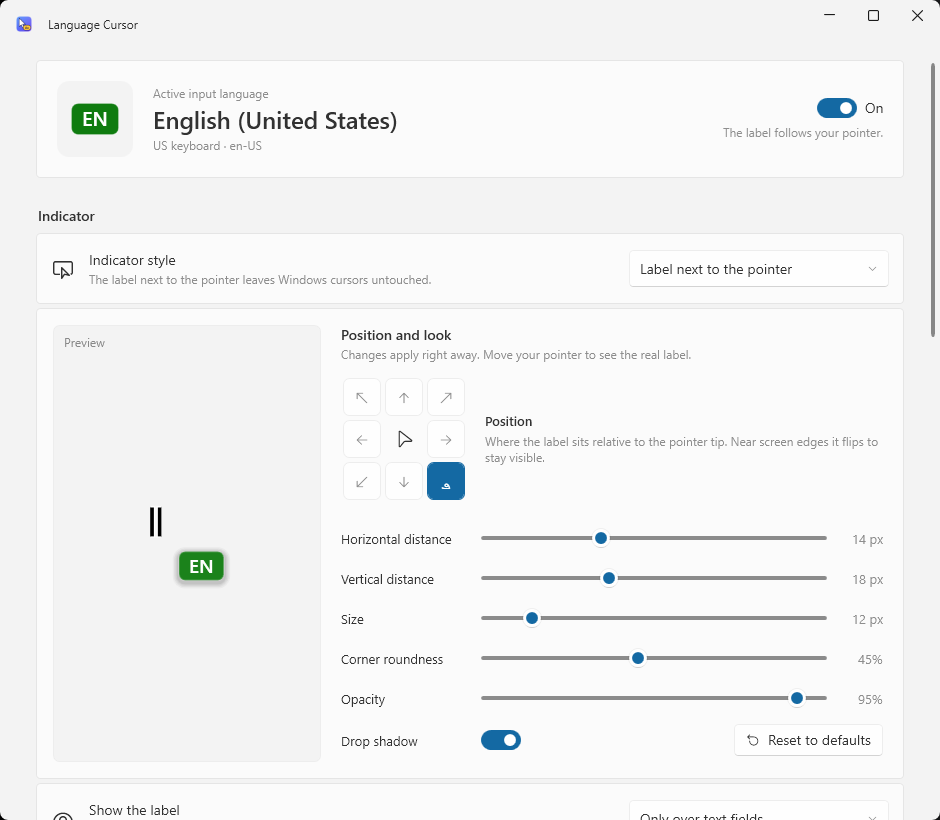
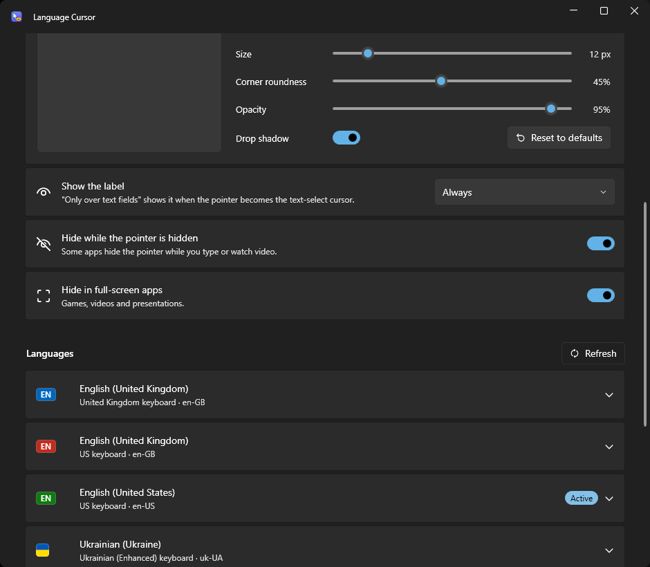

# Language Cursor



A small Windows tray app that shows your active keyboard language right next to the mouse pointer.

---

If you type in more than one language, you know the moment: you type a sentence, look up, and it came out in the wrong layout. Language Cursor puts a small label such as **EN** or **UA** beside your pointer, so you always see which layout is active without looking at the taskbar.

It follows the keyboard layout of the window you're typing in, so it stays correct when different apps use different layouts.



## Features

- **Label next to the pointer.** A small floating label follows the mouse. Windows cursors are not changed.
- **Placement you control.** Pick one of eight positions around the pointer tip and set the horizontal and vertical distance. Near screen edges the label flips to the other side so it stays visible.
- **Adjustable look.** Size, corner roundness (square to pill), opacity and drop shadow, with a live preview.
- **Show it when you need it.** Always, only over text fields, or for a moment after you switch language.
- **Stays out of the way.** Optionally hides while the pointer is hidden and in full-screen games, videos and presentations.
- **Per-language style.** Each keyboard layout gets its own label text (up to 6 characters), colour, or an image such as a flag. Text colour adjusts automatically for contrast.
- **Optional custom pointers.** Assign a `.cur` or `.ani` pointer to any layout.
- **Text-cursor mode.** If you prefer, the label can be built into the Windows text-select cursor (I-beam) instead.
- **Fits Windows 11.** Mica background, light, dark or system theme, and a tray menu that matches.
- **Lightweight and private.** Runs in the notification area, needs no admin rights, and makes no network calls.

| Light theme | Languages |
| --- | --- |
|  |  |

## Requirements

- Windows 10 or Windows 11 (Mica and rounded corners need Windows 11)
- To build from source: [.NET 8 SDK](https://dotnet.microsoft.com/download/dotnet/8.0)

## Getting started

### Run a published build

1. Download or build `LanguageCursor.exe` (see below).
2. Run it. The settings window opens, and the app keeps running in the notification area when you close it.
3. Optional: turn on **Start with Windows** under **General**. The app will then start quietly in the tray when you sign in.

The self-contained build is a single file and doesn't need .NET installed.

### Build from source

```powershell
git clone <repository-url>
cd cursor-lang
dotnet build .\LanguageCursor.sln
dotnet run --project .\LanguageCursor\LanguageCursor.csproj
```

### Publish

Self-contained single file (recommended for sharing, about 70 MB):

```powershell
dotnet publish .\LanguageCursor\LanguageCursor.csproj -c Release -r win-x64 --self-contained true `
  -p:PublishSingleFile=true -p:EnableCompressionInSingleFile=true `
  -p:IncludeNativeLibrariesForSelfExtract=true -p:DebugType=none `
  -o .\publish\LanguageCursor-win-x64
```

Framework-dependent (much smaller, but needs the [.NET 8 Desktop Runtime](https://dotnet.microsoft.com/download/dotnet/8.0)):

```powershell
dotnet publish .\LanguageCursor\LanguageCursor.csproj -c Release -r win-x64 --self-contained false `
  -o .\publish\LanguageCursor-framework-dependent
```

## Using the app

### Indicator style

| Mode | What it does |
| --- | --- |
| **Label next to the pointer** (default) | A floating label follows the pointer. Windows cursors are not changed. |
| **Label inside the text cursor** | Replaces the Windows text-select cursor with one that carries the label. It's restored when you pause or exit. |
| **Off** | No language indicator. Custom pointers still apply. |

### Languages

Every keyboard layout installed in Windows is listed. Expand one to set:

- **Label text.** Leave it empty to use the language code (`EN`, `UA`, `PL`…).
- **Colour.** Pick a swatch or enter `#RRGGBB`.
- **Image instead of text.** PNG, JPG, BMP or GIF.
- **Custom pointer.** A `.cur` or `.ani` file used while that layout is active.

Chosen files are copied into the app's data folder, so you can move or delete the originals. Layouts you add in Windows are picked up when you switch to them, or with **Refresh**.

### Tray

- **Click** the tray icon to open settings.
- **Right-click** for Pause/Resume, Restore Windows cursors, and Exit.

The icon turns grey while paused. Launching the app again while it's running brings the existing window to the front.

## Where data is stored

Everything lives in `%LocalAppData%\LanguageCursor`:

| Path | Contents |
| --- | --- |
| `settings.json` | All settings |
| `Cursors\` | Copies of chosen `.cur` / `.ani` files |
| `IndicatorImages\` | Copies of chosen label images |
| `Logs\` | Daily logs, kept for 14 days |

Start with Windows uses the current user's `Run` registry key (`HKCU\Software\Microsoft\Windows\CurrentVersion\Run`). To remove the app completely, turn off **Start with Windows**, exit it from the tray, and delete the folder above.

## How it works

- **Detecting the language.** Every 120 ms the app reads the keyboard layout of the foreground window's thread (`GetForegroundWindow`, `GetWindowThreadProcessId`, `GetKeyboardLayout`). Windows Store apps are resolved to their real input window. There is no keyboard hook and nothing is injected into other apps.
- **The pointer label.** The label is drawn in a click-through, never-focused layered window that runs on its own thread (`UpdateLayeredWindow`). While the label is visible, a low-level *mouse* hook (`WH_MOUSE_LL`) reports pointer moves so the label keeps up smoothly. The hook only reads the pointer position and is removed when the label is off or paused.
- **DPI.** The app is per-monitor DPI aware, so the label keeps the right size and position on mixed-scaling multi-monitor setups.
- **Cursors.** Custom pointers and text-cursor mode use `SetSystemCursor`. To undo them, the app calls `SystemParametersInfo(SPI_SETCURSORS)`, which reloads your own Windows cursor scheme rather than assuming the default one. If the app is ever terminated before restoring cursors, it restores them the next time it starts.

## Project structure

```text
LanguageCursor/
├── App.xaml(.cs)            Startup, single instance, crash handling, theme resources
├── AppHost.cs               Creates and wires the services
├── Assets/                  App icon
├── Models/                  Settings and language data
├── Native/NativeMethods.cs  Win32 interop
├── Rendering/               Label drawing and placement, shared by preview and overlay
├── Services/
│   ├── OverlayService.cs        Floating pointer label
│   ├── CursorService.cs         System cursor changes and text-cursor generation
│   ├── InputLanguageService.cs  Keyboard layouts and names
│   ├── InputLanguageMonitor.cs  Watches the active layout
│   ├── SettingsService.cs       settings.json and imported files
│   ├── ThemeService.cs          Light / dark / system theme
│   ├── TrayService.cs           Notification-area icon and menu
│   └── StartupService.cs        Start with Windows
├── ViewModels/              MVVM view models
└── Views/                   Main window and label controls
```

The UI uses [WPF-UI](https://github.com/lepoco/wpfui) for Fluent (Windows 11) controls.

## Troubleshooting

- **The label doesn't appear.** Check that the switch at the top of the window is **On**, the indicator style is **Label next to the pointer**, and **Show the label** isn't set to a mode that hides it right now (for example *Only over text fields*).
- **My pointer looks wrong after a crash.** Choose **Restore Windows cursors** in the tray menu or under **General**, or just start the app again.
- **A new layout isn't listed.** Select **Refresh** next to **Languages**.
- **Something else.** Check the latest file in `%LocalAppData%\LanguageCursor\Logs`.
